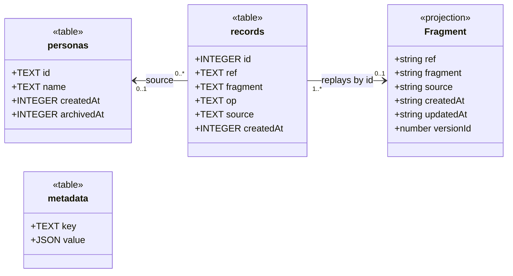

# RFC 0007: Log sequence keys and record timestamps

- Status: Accepted
- Created: 2026-11-19
- Discussion: [Amp thread](https://ampcode.com/threads/T-01a1f16c-857a-7549-8242-f04fb81ae3f5)
- Updates: [RFC 0001](0001-append-only-fragment-log.md) and [RFC 0006](0006-natural-language-memory.md)

## Summary

The memory core decouples log order, memory identity, and write timestamps in the append-only fragment log.

Each log record receives a strictly increasing integer primary key `id` that orders the log within a storage instance, keeps the 7-character `ref` as the portable memory identifier, and replaces `at` with wall-clock `createdAt`. Replaying the log by position projects active fragments with both `createdAt` and `updatedAt`, plus `versionId` referencing the latest record. NDJSON interchange stays at `v` 1, renames `at` to `createdAt`, and uses line position as causal order.

## Why

RFC 0001 and RFC 0006 use a single timestamp `at` to represent wall-clock write time, version order within a memory, the global snapshot cutoff, half of the composite primary key, and pagination cursors. Three design flaws follow from that overloading:

- **Ambiguous timestamp semantics.** A bare `at` field reads as the time an event in the memory occurred rather than when the record was written. Exposing only the latest record's timestamp on `Fragment` also discards when the memory was first recorded, so a later edit shifts its apparent creation date and misleads relative-date interpretation.
- **Clock distortion from ordering rules.** Using timestamps as a total order requires a monotonic logical clock across writes. Importing a single record with a future timestamp pushes the clock floor forward and falsifies the timestamps of all subsequent writes. Conversely, batch imports that share one timestamp fall back to sorting by random `ref` and lose their input order.
- **Brittle version addressing.** Identifying a historical version by `(ref, at)` ties APIs and optimistic concurrency checks to millisecond timestamp formatting and forbids two mutations within the same millisecond.

## Terms

- **Record**: an immutable entry appended to the log for one `remember`, `revise`, `forget`, or `restore` operation.
- **Sequence key `id`**: a strictly increasing positive integer assigned by the local SQLite store on append and never reused after deletion.
- **Entity reference `ref`**: a 7-character unambiguous base32 identifier shared by all records of one logical memory across instances.
- **Fragment**: the current state of an active memory projected by replaying all records of one `ref` in sequence order.

## Data model

`records` is clustered by its autoincrement primary key `id`, where `fragment` and `source` are nullable and `createdAt` stores epoch milliseconds. Two composite secondary indexes cover access patterns: `(ref, id)` for per-memory history, predecessor lookup, and purge, and `(createdAt, id)` for chronological activity views with deterministic tie-breaking.

## Decisions

### 1. Separate sequence, identity, and write time

Each identifier and timestamp has one role:

| Field | Scope | Guarantee | Role |
| --- | --- | --- | --- |
| `id` | Single storage instance | Strictly increasing, never reused after `purge` | Primary key, causal replay order, snapshot cutoff watermark, and version handle |
| `ref` | Portable across instances | 7-character random base32 | Groups versions of one memory, guards model tool calls against target collisions, and keys cross-instance import merges |
| `createdAt` | Portable across instances | Wall-clock time at write | Records when the log entry was created without logical clock shifts |

`id` uses SQLite `AUTOINCREMENT` so that purging the most recent memory never reassigns its sequence number to a later write.

SQLite stamps `createdAt` with `(cast(round(unixepoch('subsecond') * 1000) as integer))` when omitted, keeping millisecond precision without letting normal writes choose their own time. Imports keep the times their file states.

`ref` remains separate from `id` for two reasons. First, internal model loops address memories by `ref` when revising or forgetting. In a sparse 34-billion namespace, a mistyped or hallucinated identifier fails with `not-found`, whereas a dense integer sequence would silently mutate an adjacent memory. Second, independent instances allocate sequence numbers from `1`, so cross-instance imports require a location-independent entity identifier.

### 2. Define causality by log position

An append-only log defines order by entry position rather than wall-clock timestamps:

1. **Local storage.** Replay, version history, predecessor lookup, and the prompt snapshot cutoff order records by `id`. Writes stamp `createdAt` from the system clock without `latestAt` floors, so concurrent writes may share `createdAt`.
2. **NDJSON interchange.** Log records remain at schema version `1` and rename `at` to `createdAt` in ISO 8601 UTC millisecond format, matching persona records. `id` is omitted from exports because sequence numbers belong to one instance.
3. **Export and import order.** Full-history exports emit records in ascending `id` order. Snapshot exports emit active fragments in ascending `versionId` order using each fragment's `updatedAt` as the snapshot record's `createdAt`; collapsing history into one record intentionally drops original `createdAt` (only full-history export preserves it). Import validates and replays records in file line order without sorting by timestamp or rejecting equal timestamps on the same `ref`, and inserts accepted records in their original relative order across memories.
4. **Chronological views.** Activity feeds order entries by `(createdAt DESC, id DESC)`, active memory lists order by `(updatedAt DESC, versionId DESC)` (paging on `(updatedAt, versionId)`), and forgotten memory lists order by `(forgottenAt DESC, latestId DESC)`. Calendar grouping and recency stay chronological after historical imports while same-millisecond entries keep deterministic write order. Because wall-clock `createdAt` is decoupled from causal `id`, a future-dated or out-of-order import can appear in a different order in chronological views than in per-memory `History` or predecessor diffs.

### 3. Project creation and update times onto Fragment and address versions by id

Replaying a `ref`'s records in ascending `id` order sets `Fragment.createdAt` from its first non-null record and updates `Fragment.updatedAt` and `Fragment.versionId` on each non-null record. A null record removes the `ref` from the active projection while preserving its original creation time if a later record restores it.

Naming the record pointer `versionId` on `Fragment` (and `ForgottenFragment`, where it points to the last non-null record) keeps it distinct from `ref`. Owner-facing version operations, including version restore, forgotten-memory restore, and optimistic concurrency checks during tidy runs, reference `id` rather than ISO timestamp strings. Restore returns both the projected `fragment` (or `null` when restoring a `forget`) and the newly appended `version` record so callers keep the memory's original `createdAt`.

## Not in this RFC

- **Prompt design for the memory model.** How prompts present `createdAt`, `updatedAt`, and revision history to the model belongs in a separate RFC.
- **Legacy NDJSON compatibility.** Pre-release files that use `at` are not supported.
- **Multi-writer replication.** Each memory space retains a single writer.

## Alternatives considered

### Allow sequence number reuse on delete

A plain SQLite rowid alias without `AUTOINCREMENT` reuses the highest `id` when the tail record is purged. Reusing sequence numbers breaks the invariant that a larger `id` always represents a later event, invalidating cached watermarks and concurrency tokens.

### Replace ref with sequential integer memory IDs

Using the first record's `id` as the memory identifier eliminates `ref`, but turns the identifier space into a dense integer range where model off-by-one errors corrupt unrelated memories, and causes identifier collisions whenever logs from two instances merge.

### Retain a per-ref hybrid logical clock

Advancing `createdAt` by `+1ms` per `ref` keeps `(ref, createdAt)` unique, at the cost of falsifying write timestamps after rapid edits or future-dated imports. Once `id` in storage and line position in NDJSON carry causality, logical clock adjustments serve no purpose.

## Migration

Existing instances migrate in place within a single transaction:

1. Rebuild `records` ordered by `(at ASC, ref ASC)` to assign initial monotonic `id` values while copying `at` into `createdAt`.
2. Create the `(ref, id)` and `(createdAt, id)` secondary indexes.
3. Clear any persisted snapshot cutoff cursor so the next read establishes a watermark in `id` units rather than epoch milliseconds.
